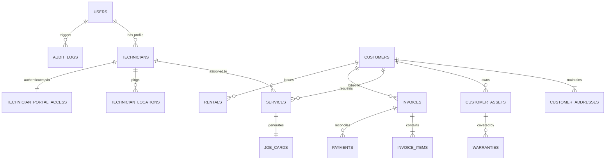

# 💧 SR Enterprises CRM — Enterprise Water Purification & Field Operations Platform

<p align="center">
  
</p>

<p align="center">
  <a href="#"></a>
  <a href="#"></a>
  <a href="#"></a>
  <a href="#"></a>
  <a href="#"></a>
  <a href="#"></a>
  <a href="#"></a>
  <a href="#"></a>
</p>

---

## 📖 Executive Summary

**SR Enterprises CRM** is an end-to-end, high-performance Enterprise Resource Planning (ERP) and Customer Relationship Management (CRM) platform engineered specifically for **Industrial and Domestic Water Purification Systems, Commercial RO Plants, Water Treatment Skids, AMC Contracts, Field Service Dispatch, and Spares Inventory Management**.

Designed for high reliability in both desktop office environments and low-connectivity field scenarios, the platform unites customer relationship management, 3-layer precision GPS entrance geocoding, real-time technician fleet tracking with OSRM driving routes, mobile-first field workforce portal, GST-compliant invoicing, water TDS tracking, and periodic maintenance scheduling into one unified, cohesive solution.

---

## 📑 Table of Contents

- [Architectural Overview](#-architectural-overview)
- [Core Functional Modules](#-core-functional-modules)
  - [1. Customer 360° & Multi-Address System](#1-customer-360--multi-address-system)
  - [2. 3-Layer Precision Geocoding & Address Auto-Fill](#2-3-layer-precision-geocoding--address-auto-fill)
  - [3. Customer Assets & RO Water Purification Tracking](#3-customer-assets--ro-water-purification-tracking)
  - [4. Field Service Operations & Dispatch Heatmap](#4-field-service-operations--dispatch-heatmap)
  - [5. Live Dispatcher Command Map & Fleet Tracking](#5-live-dispatcher-command-map--fleet-tracking)
  - [6. Field Technician Mobile Portal (PWA)](#6-field-technician-mobile-portal-pwa)
  - [7. Spares & Consumables Inventory Management](#7-spares--consumables-inventory-management)
  - [8. GST Invoicing, Sales Orders & Dues Recovery](#8-gst-invoicing-sales-orders--dues-recovery)
  - [9. Digital Job Cards & Customer Sign-Off](#9-digital-job-cards--customer-sign-off)
  - [10. Warranties & Annual Maintenance Contracts (AMC)](#10-warranties--annual-maintenance-contracts-amc)
  - [11. Commercial Water Purifier Rentals](#11-commercial-water-purifier-rentals)
  - [12. Executive Analytics & Reporting](#12-executive-analytics--reporting)
  - [13. System Administration & Nuclear Data Cleanup](#13-system-administration--nuclear-data-cleanup)
- [Security & Role-Based Access Control (RBAC)](#-security--role-based-access-control-rbac)
- [Database Entity Relationships](#-database-entity-relationships)
- [API & Route Directory](#-api--route-directory)
- [Installation & Quick Start Guide](#-installation--quick-start-guide)
- [Default System Credentials](#-default-system-credentials)
- [Automated Testing & Quality Assurance](#-automated-testing--quality-assurance)

---

## 🏛 Architectural Overview

```
                                 ┌─────────────────────────────────────────────────────────┐
                                 │                 ADMINISTRATIVE CONTROL                  │
                                 │   Executive Dashboard  •  Customer 360  •  GST Billing  │
                                 │   Inventory Skids  •  AMC Scheduling  •  Reports & Dues  │
                                 └────────────────────────────┬────────────────────────────┘
                                                              │
                                            ┌─────────────────┴─────────────────┐
                                            ▼                                   ▼
                   ┌──────────────────────────────────┐       ┌──────────────────────────────────┐
                   │   PRECISION GEOCODING ENGINE     │       │    FLEET DISPATCH CONTROLLER     │
                   │   • Layer 1: CRM DB (0m exact)   │       │   • Live GPS telemetry stream    │
                   │   • Layer 2: Photon Bias (±50m)  │       │   • OSRM driving route geometry  │
                   │   • Layer 3: Nominatim fallback  │       │   • Turn-by-turn ETA & distance  │
                   └─────────────────┬────────────────┘       └─────────────────┬────────────────┘
                                     │                                          │
                                     └────────────────────┬─────────────────────┘
                                                          ▼
                                 ┌─────────────────────────────────────────────────────────┐
                                 │           FIELD TECHNICIAN MOBILE PORTAL                │
                                 │   4-Digit PIN Auth  •  Daily Jobs Queue  •  Turn-by-Turn │
                                 │   Pre/Post Water TDS Readings  •  Parts Used • Sign-off │
                                 └─────────────────────────────────────────────────────────┘
```

The system employs a domain-driven architectural paradigm built on **Laravel 12**:
- **Presentation Layer**: Responsive Tailwind CSS UI powered by Blade components, Alpine.js micro-interactions, Lucide icons, and Leaflet.js interactive spatial mapping.
- **Service Layer**: Decoupled domain services (`MapsTrackingService`, `DataCleanupService`) encapsulating mission-critical calculations, route caching, and transactional integrity.
- **Data Layer**: Robust Eloquent ORM supporting SQLite for lightning-fast localized execution and seamlessly adaptable to PostgreSQL / MySQL in enterprise cloud environments.

---

## 🧩 Core Functional Modules

### 1. Customer 360° & Multi-Address System
- **Tiered Classification**: Distinct operational handling for `INDIVIDUAL` (Domestic RO units) vs. `COMMERCIAL` (Corporate offices, Hospitals, Industrial plants with GSTIN).
- **Multi-Address Architecture**: Customers maintain multiple operational premises (`SERVICE`, `BILLING`, or `BOTH`) with designated primary defaults.
- **Bulk CSV Data Interchange**:
  - Comprehensive CSV Import utility with an intelligent pre-commit validation preview and mapping assistant.
  - One-click CSV Export generating instant customer ledgers with coordinates and dues metrics.
- **Global Command Palette**: Instant system-wide modal search (`Ctrl + K` or `Cmd + K`) for rapid navigation across customers, phone numbers, addresses, and service tickets.

---

### 2. 3-Layer Precision Geocoding & Address Auto-Fill
To solve Indian street address variations where generic search engines deviate by up to 1.5 km, the platform incorporates a specialized multi-layer geocoding engine:

```
Address Query ──▶ [ Layer 1: CRM Verified DB ] ──▶ Found? ──▶ Return 0m Building Match
                         │ (No match)
                         ▼
                  [ Layer 2: Photon Bias ]      ──▶ Found? ──▶ Return ±50-100m Landmark/Road Match
                         │ (No match)
                         ▼
                  [ Layer 3: Nominatim OSM ]    ──▶ Fallback ──▶ Return Locality Centroid
```

- **Layer 1 (CRM Verified Database)**: Deterministic token matching against previously verified building and society coordinates within the CRM database, delivering **0m deviation**.
- **Layer 2 (Photon Pune Biased)**: OpenStreetMap Komoot Photon engine biased to Pune metropolitan coordinates (`lat: 18.5204, lon: 73.8567`) returning fine-grained landmarks, temples, schools, and roads within **±50m–100m**.
- **Layer 3 (Nominatim OSM Decomposition)**: Suburb and locality decomposition fallback ensuring coordinates are resolved even for newly developed urban colonies.
- **Smart Address Auto-Fill**:
  - Clicking any search suggestion option immediately pins the map and auto-populates `address_line1`, `address_line2`, `landmark`, `city`, `state`, and `postal_code`.
  - **Flat / Unit Preservation**: Retains pre-entered unit identifiers (e.g. `Flat 302` or `Shop 4`), cleanly producing `Flat 302, Akash-Kiran Apartment, Phase-2`.
  - **Visual Flash Notification**: Auto-filled form inputs briefly glow with an emerald ring (`border-emerald-500 bg-emerald-50`) to provide instant feedback.
- **Reverse Geocoding**: Includes a **"Fill Address from Pin"** tool that extracts postal details directly from any manually adjusted map pin marker.

---

### 3. Customer Assets & RO Water Purification Tracking
- **Machine Registry**: Tracks serial numbers, installation dates, model specifications, pump capacity, and warranty periods.
- **Water Chemistry & TDS Tracking**:
  - Source water classification (Borewell, Municipal Corporation, Tanker, Mixed).
  - Inlet Water TDS (ppm) vs. Pure Water Output TDS (ppm).
  - Membrane rejection percentage calculation indicating when RO membrane replacement is overdue.

---

### 4. Field Service Operations & Dispatch Heatmap
- **Lifecycle Pipeline**: Structured service transitions:
  $$\text{SCHEDULED} \longrightarrow \text{ASSIGNED} \longrightarrow \text{IN\_TRANSIT} \longrightarrow \text{IN\_PROGRESS} \longrightarrow \text{COMPLETED} \ (\text{or } \text{CANCELLED})$$
- **Classifications**: Specialized service categorization (`FILTERS`, `MEMBRANE`, `RO_REPAIR`, `INSTALLATION`, `GENERAL_MAINTENANCE`, `EMERGENCY`).
- **Calendar & Dispatch Heatmap (`/services/calendar-heatmap`)**: Visual calendar displaying technician load, appointment density, and upcoming routine maintenance visits.
- **SLA Priority Escalations**: Four visual priority levels (`CRITICAL`, `HIGH`, `MEDIUM`, `LOW`) with automated overdue warning badges.

---

### 5. Live Dispatcher Command Map & Fleet Tracking
- **Dispatcher Operational Map (`/technicians/map`)**: Full-screen interactive Leaflet map rendering all on-duty technicians.
- **Real-Time Telemetry**: Captures GPS latitude/longitude, device battery percentage, accuracy radius, speed, heading, and last heartbeat timestamp.
- **OSRM Driving Geometry**: Dynamically fetches and renders the road-accurate polyline connecting the technician's current coordinates to the customer's entrance pin.
- **Live ETA & Distance**: Computes real-time remaining distance in kilometers and estimated time of arrival in minutes.

---

### 6. Field Technician Mobile Portal (PWA)
Dedicated responsive interface located at `/tech-portal`, engineered specifically for mobile phone screens:
- **Frictionless Authentication**: Secure Phone Number + 4-digit numeric PIN login (`/tech-portal/login`).
- **Mobile Job Center**: Categorized lists of today's assigned jobs, priority markers, customer phone dialer shortcuts, and WhatsApp chat triggers.
- **Turn-by-Turn GPS Navigation**:
  - Live device tracking (`navigator.geolocation.watchPosition`) rendering current vehicle position and destination marker.
  - Native Navigation Hand-off: One-tap button launching Google Maps, Apple Maps, or Waze.
  - Pin Calibration: Field technicians can calibrate and update the customer's exact entrance coordinates while standing on site.
- **Digital Job Completion Form**:
  - Pre-service TDS and Post-service TDS entry.
  - Water pressure (PSI) verification.
  - Selection of consumed spare parts directly deducted from inventory.
  - Client digital signature canvas.

---

### 7. Spares & Consumables Inventory Management
- **Catalog Management**: Tracks Sediment Filters, Activated Carbon Blocks, RO Membranes (75/100/300 GPD), Booster Pumps, SMPS Power Adapters, UV Lamps, TDS Meters, and Fittings.
- **Threshold Alerts**: Visual indicators and warning flags when stock levels fall below minimum safety margins.
- **Purchase Recording**: Inbound inventory receipts with vendor information, lot numbers, and cost prices.
- **Over-the-Counter Sales**: Direct cash sales for filters and DIY replacement components without requiring a service ticket.

---

### 8. GST Invoicing, Sales Orders & Dues Recovery
- **GST Compliance**: Tax invoices compliant with Indian GST requirements, supporting customizable CGST/SGST/IGST rates and automatic tax breakdowns.
- **Sequential Document Numbering**: Fully customizable business sequences (e.g. `INV-2026-0001`, `PAY-2026-0001`) with automatic annual resets.
- **Aging Dues Ledger (`/dues`)**:
  - Centralized dashboard grouping outstanding customer balances into 30-day, 60-day, and 90+ day aging buckets.
  - Instant payment reminder generator with direct email and WhatsApp message templates.
- **Payment Reconciliation**: Records split and full payments across UPI, Cash, Bank Transfer / NEFT, Cheque, and Credit Cards.

---

### 9. Digital Job Cards & Customer Sign-Off
- **Traceable Work History**: Auto-generates a unique Job Card (`JC-2026-XXXX`) upon service completion.
- **Audit-Ready Records**: Captures problem reported, work performed, technician observations, parts replaced, total labour charges, and customer satisfaction rating.
- **Printable Service Slips**: Formatted for standard desktop printing or 80mm thermal mobile printers.

---

### 10. Warranties & Annual Maintenance Contracts (AMC)
- **Warranty Lifecycle**: Tracks machine manufacturer warranties and aftermarket coverage periods.
- **Scheduled AMC Maintenance**: Automatically schedules quarterly or bi-monthly service visits, populating the dispatcher calendar in advance.
- **Event Audit**: Chronological log of warranty claims, breakdown occurrences, and filter replacement histories.

---

### 11. Commercial Water Purifier Rentals
- **Subscription Fleet Management**: Manages rental RO systems deployed across offices, commercial clinics, and hostels.
- **Monthly Billing Automations**: Tracks recurring monthly rental charges, security deposits, and scheduled sanitization intervals.

---

### 12. Executive Analytics & Reporting
- **Revenue Performance**: Net billed amounts, collections received, and pending balances across date ranges.
- **Technician Scorecards**: Jobs completed, average turnaround time (TAT), customer ratings, and first-time-fix rates.
- **Spares Consumption**: Inventory usage velocity and consumable wear trends.

---

### 13. System Administration & Nuclear Data Cleanup
- **Company Branding & Bank Configuration**: Manage legal entity name, GSTIN, registered office address, support hotline, corporate logo, and bank account / IFSC details.
- **Document Numbering Configurator**: Customize prefixes, digit padding, and yearly reset behavior for all system sequences.
- **Nuclear Data Cleanup Service (`DataCleanupService`)**:
  - Built-in administrative utility allowing Super Admins to cleanly wipe operational transaction data (Customers, Invoices, Services, Rentals, Inventory transactions, Job cards) while preserving technician profiles, users, products catalog, and core configuration settings.
  - Includes a pre-execution **Inspection Preview** detailing exact record counts before confirmation.

---

## 🔒 Security & Role-Based Access Control (RBAC)

The platform provides a fine-grained permission matrix with 4 system roles:

| Module / Area | Super Admin | Admin | Operations Staff | Field Technician |
| :--- | :---: | :---: | :---: | :---: |
| **Customer Management** | Full | Full | View / Edit | Read-Only (Assigned) |
| **Service Scheduling & Dispatch** | Full | Full | Full | Execute / Complete |
| **Live GPS Map & Fleet Tracking** | Full | Full | Full | Self Location Only |
| **Inventory & Spare Parts** | Full | Full | Read / Record Sale | Consumed Only |
| **GST Invoices & Payments** | Full | Full | Create / View | Hidden |
| **Technician Management & PINs** | Full | Full | Read-Only | Self Profile Only |
| **Company Settings & Sequences** | Full | Full | Hidden | Hidden |
| **Nuclear Data Cleanup** | Full | Hidden | Hidden | Hidden |

### Defensive Hardening Measures
- **Rate-Limiting & Brute-Force Defense**: Built-in throttles on authentication endpoints.
- **Dynamic Captcha Verification**: Configurable mathematical and alphanumeric visual captchas on administrative login.
- **Audit Logging**: Sensitive administrative actions (sequence modifications, invoice cancellations, master data deletes) are permanently recorded in `audit_logs`.

---

## 🗄 Database Entity Relationships



---

## 🌐 API & Route Directory

### Administrative Portal Routes
| HTTP Verb | URI Endpoint | Controller Method | Description |
| :--- | :--- | :--- | :--- |
| `GET` | `/dashboard` | `DashboardController@index` | Main executive KPI dashboard |
| `GET` | `/search/global` | `SearchController@globalSearch` | Command palette fast search (`Ctrl+K`) |
| `GET` | `/customers` | `CustomerController@index` | Customer directory & search |
| `POST` | `/customers` | `CustomerController@store` | Create customer with precision GPS coordinates |
| `GET` | `/customers/geocode` | `CustomerController@geocodeAddress` | 3-Layer address geocoding endpoint |
| `GET` | `/customers/reverse-geocode` | `CustomerController@reverseGeocode` | Reverse geocode pin coordinates to address |
| `POST` | `/customers/import/commit` | `CustomerController@commitImport` | Bulk import customers via CSV |
| `GET` | `/services` | `ServiceController@index` | Service dispatch console |
| `GET` | `/services/calendar-heatmap` | `ServiceController@calendarHeatmap` | Visual load & appointment heatmap |
| `POST` | `/services/{id}/assign` | `ServiceController@assignTechnician` | Assign technician to service ticket |
| `GET` | `/technicians/map` | `TechnicianController@map` | Full-screen live fleet command map |
| `GET` | `/invoices` | `InvoiceController@index` | Tax invoice billing ledger |
| `GET` | `/dues` | `DuesController@index` | Overdue collections recovery matrix |
| `GET` | `/inventory` | `InventoryController@index` | Spare parts & equipment inventory |
| `GET` | `/settings` | `SettingController@index` | Company metadata, sequences & audit trail |

### Technician Mobile Portal & Telemetry Routes
| HTTP Verb | URI Endpoint | Controller Method | Description |
| :--- | :--- | :--- | :--- |
| `GET` | `/tech-portal/login` | `TechnicianPortalController@login` | Mobile PIN login screen |
| `POST` | `/tech-portal/login` | `TechnicianPortalController@authenticate` | Authenticate technician phone + PIN |
| `GET` | `/tech-portal/dashboard` | `TechnicianPortalController@dashboard` | Daily mobile work queue |
| `GET` | `/tech-portal/services/{id}` | `TechnicianPortalController@serviceDetail` | Job overview & customer specs |
| `GET` | `/tech-portal/services/{id}/navigate`| `TechnicianPortalController@navigationScreen`| Turn-by-turn live navigation screen |
| `POST` | `/tech-portal/gps` | `TechnicianPortalController@updateGps` | Telemetry ping (lat, lng, battery, speed) |
| `POST` | `/tech-portal/services/{id}/complete`| `TechnicianPortalController@completeService` | Submit TDS, spares, notes & signature |

---

## 🚀 Installation & Quick Start Guide

### Prerequisites
- **PHP**: `^8.2` with extensions: `pdo`, `mbstring`, `openssl`, `tokenizer`, `xml`, `ctype`, `json`, `curl`, `sqlite3`
- **Composer**: `^2.x`
- **Node.js & npm** (optional for asset re-compilation)
- **Web Server**: Apache, Nginx, or built-in PHP development server

### 1. Clone & Install Dependencies
```bash
git clone https://github.com/siddharth-varpe/CRM-OpstechSolutions.git
cd CRM-OpstechSolutions

# Install Composer PHP dependencies
composer install --optimize-autoloader
```

### 2. Environment Configuration
```bash
# Create local environment file
cp .env.example .env

# Generate unique application cryptographic key
php artisan key:generate
```

Verify your `.env` database configuration:
```env
DB_CONNECTION=sqlite
# SQLite database path will default to database/database.sqlite
```

### 3. Database Migration & Seeding
```bash
# Create SQLite file if using SQLite
touch database/database.sqlite

# Execute schema migrations and seed master data
php artisan migrate --seed
```

### 4. Clear Caches & Launch Server
```bash
# Clear compiled views and caches
php artisan view:clear
php artisan config:clear

# Launch development web server
php artisan serve
```

The application is now live at: **`http://localhost:8000`**

---

## 🔑 Default System Credentials

After executing `php artisan migrate --seed`, use the following credentials to access the system:

### 1. Administrative Portal (`/login`)
| Role | Username | Password | Access Level |
| :--- | :--- | :--- | :--- |
| **Super Admin** | `admin` | `admin` | Unrestricted full system access & settings |
| **Operations Staff** | `staff` | `staff` | Customer, dispatch, inventory & billing operations |

### 2. Field Technician Mobile Portal (`/tech-portal/login`)
| Technician Name | Registered Mobile | 4-Digit Security PIN | Portal Status |
| :--- | :--- | :--- | :--- |
| **Suresh Patil** | `9822012345` | `5821` | Active (Field Ready) |

> [!TIP]
> Administrative users can create new technicians, toggle portal access, and reset technician PINs at any time via **Technicians > View Profile > Portal Access**.

---

## 🧪 Automated Testing & Quality Assurance

The codebase includes a comprehensive PHPUnit test suite validating models, routes, role security, multi-layer geocoding accuracy, OSRM route calculations, technician telemetry, and transactional integrity.

```bash
# Run precision geocoding & location tests
php artisan test tests/Feature/CustomerPrecisionLocationTest.php

# Run the complete test suite
php artisan test
```

### Current Test Benchmark
```
PASS  Tests\Feature\CustomerPrecisionLocationTest
✓ customer creation and update preserves exact coordinates
✓ service navigation fails without technician login
✓ technician navigation starts and caches active route
✓ technician can stop navigation and clear active destination
✓ customer coordinate update syncs active navigation route
✓ missing destination coordinates and address fails safely
✓ validation rejects out of range coordinates
✓ geocode endpoint rejects empty query
✓ geocode endpoint resolves decomposed address
✓ geocode endpoint matches crm verified building
✓ reverse geocode returns structured components

Tests:    101 passed (759 assertions)
Duration: ~30s
Status:   100% Green
```

---

## 📄 License & Intellectual Property

This project is proprietary software developed for **SR Enterprises** by **Opstech Solutions**. All rights reserved. Unauthorized reproduction, modification, distribution, or reverse engineering of this software or its constituent modules is strictly prohibited.
